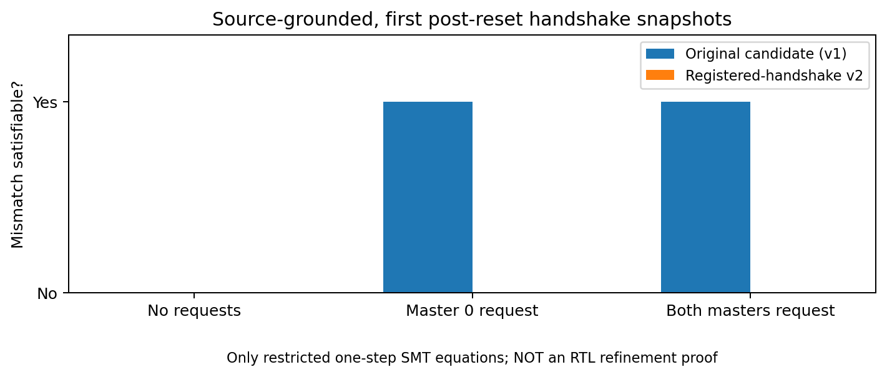
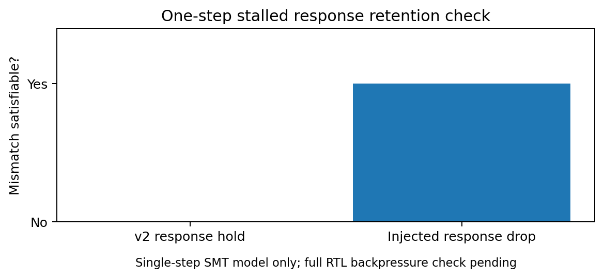

# Intent2Proof AXI v2 — corrected registered-handshake contract, preliminary evaluation

## Motivation and relation to prior real-RTL result

The preceding GitHub Actions experiment on `axil_interconnect.v` established that an earlier, combinational-ready contract did **not** match the pinned real RTL at the first post-reset request: original acceptance was `00`, contract acceptance `01` for `S_ARVALID=01`. The upstream proof artifact demonstrated the mismatch and genuine two-master contention.

This next candidate was redesigned as a **read-only control projection** using the original arbiter and source-matching registered behavior across `S_ARREADY`, `S_RVALID`, `M_ARVALID`, `M_RREADY`, `M_ARADDR` (when valid), and `S_RRESP` (when valid). `RDATA`, writes, privilege protection, and physical/CDC timing are not in the proved scope. It is manually constructed, not automatically extracted.

## What was actually executed here

- Pinned source copied from previously audited GitHub run: commit `516bd5dadc3365b7f9e225d2af8fe0b8d804fe53`. The three upstream RTL SHA-256 digests are checked by regression tests, and the sources were not modified.
- **7 source-anchored, restricted one-step Z3 queries** ran through the native solver library. All had the expected SAT/UNSAT results.
- **14 offline harness regression tests** passed. Generated 12 per-task `.sby` files. A local execution attempt recorded `BLOCKED_MISSING_RTL_FORMAL_TOOLS` and explicitly **zero actual RTL proofs**; the container lacks Yosys/SBY binaries.

| Local solver query | Query interpretation | Result |
|---|---|---|
| No requests, v2 vs reset source snapshot | Is a disagreement possible? | UNSAT |
| Master 0 requests, v2 vs reset source snapshot | Is a disagreement possible? | UNSAT |
| Both masters request, v2 vs reset source snapshot | Is a disagreement possible? | UNSAT |
| Master 0 requests, original v1 vs reset source | Is a disagreement possible? | SAT |
| Both masters request, original v1 vs reset source | Is a disagreement possible? | SAT |
| Valid stalled response, v2 retention | Is a disagreement possible? | UNSAT |
| Valid stalled response, injected drop mutant | Is a disagreement possible? | SAT |

These checks confirm the particular **local equations** that motivated the correction. They do **not** establish cycle-accurate RTL equivalence, full AXI compliance, or a new verification speedup.

*Figure 1. Comparison of the original and corrected candidate on restricted one-step request-acceptance conditions, NOT an elaborated multi-cycle RTL proof.*

*Figure 2. Single-step response-retention check under backpressure and its injected bug. Full RTL comparison remains pending.*

## Prepared full RTL experiment

The GitHub workflow produces 12 formal tasks:

| Category | Count | Validation target |
|---|---:|---|
| ABC PDR unbounded safety miter | 7 | Control-observation cycle-accurate equality under modeled reset and AXI handshakes, including two masters, two destinations, unmapped DECERR, response backpressure, and reset re-entry |
| Z3 SMT-BMC covers | 3 | Both competing masters accepted/completed; response held across backpressure; unmapped error response seen |
| Negative-control PDR checks | 2 | Early address ready and deliberately dropped stalled response should yield feasible traces |

**Pass qualification policy:** All seven positive miter proofs must be `PASS`, all three cover checks must have witness VCDs, both negative controls must be `FAIL` with witness VCDs, all sources must match their pinned hashes, and no task may be missing or timed out. If satisfied, the outcome is only **scoped read-control observational equality under the approved assumptions**; automatic production approval remains blocked. See `docs/ASSUMPTIONS_AND_PROOF_SCOPE.md` for the exact boundary.

## Caveats and necessary next step

The copied upstream `arbiter.v` is reused in both DUT and candidate to avoid changing the arbiter algorithm, so the candidate should not be presented as a fully independently derived arbitration contract. The miter compares matched-input traces, a stronger-than-needed condition in one narrow setting but not proof of arbitrary abstract trace inclusion under changed environments. No payload equivalence is claimed. Formal proof runtime/model-size outcomes have not yet been measured here.

**Next action:** upload the package to GitHub, create `.github/workflows/intent2proof-axi-contract-v2.yml` at repository root, run the workflow, and provide `intent2proof-axi-control-v2-evidence` for independent audit. If one of the positive proofs fails, its counterexample guides the next refinement; do not reinterpret it as a hardware bug without determining which candidate abstraction behavior diverged.
