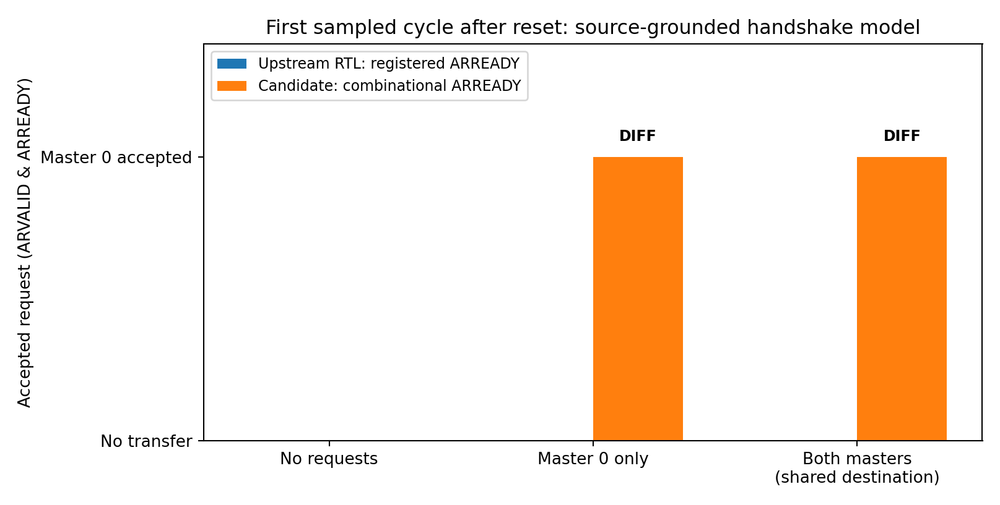
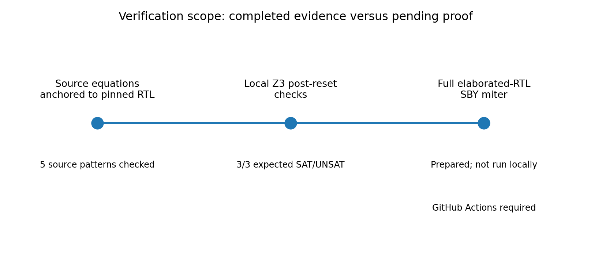

# Intent2Proof: AXI-Lite abstraction refinement and true contention

## Executive finding

The prior formal run established separately that a pinned `axil_interconnect` and a smaller candidate bridge satisfy selected cross-IP *safety assertions*. It did **not** establish that the candidate bridge implements or conservatively abstracts the original interface. The new source-anchored one-step SMT check exposes a cycle-accurate difference: after reset, an asserted ARVALID sees ARREADY=0 in the original registered-ready interface, but ARREADY=1 in the candidate's combinational-ready interface. Both one-master and dual-master cases are SAT for a handshake mismatch. A no-request case is UNSAT for mismatch.

**Qualification:** The current candidate is not suitable as a drop-in *cycle-exact* refinement under matched environment inputs. This does not, by itself, establish that all weaker observational abstractions fail. The full-RTL miter and genuine contention-cover tasks have been prepared but have **not** been run in the current container.

## Provenance and methods

- Open-source upstream: `alexforencich/verilog-axi`, `axil_interconnect.v`, `arbiter.v`, `priority_encoder.v`.
- Git commit recorded from the previous successful GitHub Actions artifact: `516bd5dadc3365b7f9e225d2af8fe0b8d804fe53`.
- Files are copied from that uploaded artifact and checked against SHA-256 checksums before a formal run; third-party license is included.
- Locally authored components: `axi_hetero_top`, `axi_read_contract_bridge`, `axi_slow_read_slave`; the top-level 2-bit-to-4-bit AXI response-width issue from the preceding audit is corrected.
- Local method: five strict source-shape checks, then native Z3 via libz3 on a deliberately narrow *post-reset, first-sampled-cycle handshake model*.
- Full RTL method, ready for GitHub Actions: SBY two-implementation miter with matched AXI environment inputs, plus two-master same-destination request and completion cover and negative-control mutations.

## Completed local checks

| Post-reset input | Original acceptance (`ARVALID & ARREADY`) | Candidate acceptance | SMT query requiring a difference |
|---|---|---|---|
| `ARVALID=00`, no request | `00` | `00` | UNSAT |
| `ARVALID=01`, master 0 requests | `00` | `01` | SAT |
| `ARVALID=11`, both masters request | `00` | `01` | SAT |

The first-cycle result follows from source statements visible in the pinned implementation: `s_axil_arready_reg = 0` and `assign s_axil_arready = s_axil_arready_reg`, versus the candidate's idle-state combinational `assign s_arready = ...`. It assumes a valid reset phase and request presentation after reset deassertion. It is **not** an exhaustive parse or executable HDL equivalence proof. The full SBY miter addresses that missing evidence.

- All **10/10** offline harness regression tests passed.
- The full-RTL runner performed preflight and produced `BLOCKED_MISSING_FORMAL_TOOLS`; no new Yosys or SBY proof was executed in this container.

## Prepared actual RTL experiment (eight SBY tasks)

| Task | Intended check | Expected outcome, not yet observed |
|---|---|---|
| `miter_single_req` | Cycle-exact accepted AR events, one requesting master | FAIL with trace |
| `miter_dual_req` | Same check with two masters | FAIL with trace |
| `miter_no_req_sanity` | No-request equality sanity | PASS (ABC PDR) |
| `miter_mismatch_cover` | Existence of post-reset mismatch | PASS with trace |
| `shared_contention_cover` | Both masters pending for slave 0, both accepted and completed | PASS with trace |
| `shared_contention_safety` | No orphan responses and safe shutdown under shared-destination traffic | PASS (ABC PDR) |
| `shared_route_mutant` | Deliberately misrouted response (same shared slave) | FAIL with trace |
| `shared_shutdown_mutant` | Deliberately weakened shutdown predicate | FAIL with trace |

The miter compares **accepted request events** and uses shared, exogenously constrained read-side inputs. Its failure is a counterexample to lockstep cycle-exact equivalence at that observation alphabet. It does *not* automatically settle more permissive trace-inclusion relations with abstraction nondeterminism, stutter tolerance, or different interface boundaries. Those would need explicitly defined relations and separate proofs.

For true contention, the system benchmark constrains both request destinations to slave 0 and includes a cover requiring both masters to have simultaneously pending address requests, and each to later produce an accepted request and a completed read response. Merely placing two masters in one system is not counted as contention.

## Interpretation and design decision

The current deterministic contract bridge should not be promoted to a sound cycle-accurate substitution merely because its independent safety assertions pass and its AIG is smaller. The appropriate next design change is to (1) preserve the relevant registered-ready and arbitration behavior or (2) introduce a conservative nondeterministic contract with an independently discharged RTL guarantee, then formally prove the corresponding refinement/simulation obligation. Only after qualification should performance comparisons with standard COI be used to argue for a safe abstraction advantage.

**Automated approval status: REVIEW_REQUIRED.** The benchmark's runner distinguishes *expected negative-control failures* from *formal qualification*. A green GitHub workflow, if achieved, will mean the expected experiment verdicts and traces were obtained; it will **not** mean the candidate abstraction has been approved.

## Run in your GitHub repository

1. Extract the ZIP directly at the repository root so `.github/workflows/intent2proof-axi-refinement.yml` is under the root `.github` directory and `Intent2Proof_AXI_Refinement/` is a sibling.
2. Commit to the default branch.
3. Select **Actions → Intent2Proof AXI refinement and true contention → Run workflow**. This uses OSS CAD Suite, pinned source files included with the package, no network source clone.
4. Download the artifact **`intent2proof-axi-refinement-evidence`**, including `RUN_STATUS.json`, `.sby` tasks, VCD traces, engine logs, and AIG model measurements.
5. Upload the artifact for independent audit. Do not automatically approve a contract marked `REJECTED` or `NOT_PROVED`.

## Verification limitations

No claim is made of full AXI protocol compliance, liveness/fairness, data-integrity proof, physically timed CDC correctness, actual hardware deployment, or a statistically significant formal runtime speedup. Formal tasks are restricted to the read-only instantiated interface and their chosen reset/environment assumptions. The copied pinned upstream RTL is real source, but the two-implementation miter has not yet been executed here because Yosys and SBY executables are unavailable.
